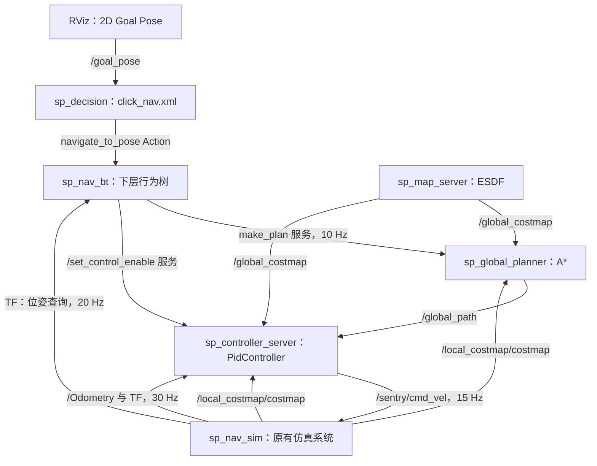

# ROS 2 Humble 迷宫自主导航

本项目面向「27 算法组导航方向招新大作业」，在给定迷宫中实现 **固定起点出发、一次发布目标、自动规划、闭环跟踪、准确停车** 的完整导航流程。

机器人从地图坐标 **`(0.900, 0.900)`** 出发，在 RViz 中向 **`(14.100, 14.100)`** 发布一次目标。上层行为树接收任务，下层行为树调用 A* 规划，控制器通过全向平移跟踪路径，直至进入 **5 cm 到达范围**。导航过程中不拖动机器人、不更换目标、不手动发布速度指令。

当前推荐参数已在未修改的项目仿真器中完成 **3 次**完整验证：用时 **97.77 / 100.16 / 97.57 s**，平均 **98.50 s**，三轮均未采样到全局或局部不可通行膨胀区，无脱困，最小离墙间距不低于 **55.13 cm**。
## 目录

1. [任务场景与实现内容](#1-任务场景与实现内容)
2. [系统架构与数据流](#2-系统架构与数据流)
3. [运行环境与编译](#3-运行环境与编译)
4. [启动与评测操作](#4-启动与评测操作)
5. [规划与运动控制的主要思路](#5-规划与运动控制的主要思路)
6. [主要参数设定](#6-主要参数设定)
7. [多轮运行记录与结果分析](#7-多轮运行记录与结果分析)
8. [调试问题与解决方案](#8-调试问题与解决方案)
9. [文件组织与代码管理](#9-文件组织与代码管理)

## 1. 任务场景与实现内容

### 1.1 场景与评价目标

| 项目 | 设定 |
|---|---|
| 地图 | `maze_map.pgm` / `maze_map.yaml` |
| 尺寸与分辨率 | `15 m × 15 m`，`300 × 300`，`0.05 m/pixel` |
| 走廊宽度 | 约 `1.50 m` |
| 固定起点 / 终点 | `(0.900, 0.900)` / `(14.100, 14.100)`，均为 `map` 系坐标 |
| 操作方式 | RViz `2D Goal Pose` 单次发布目标 |
| 到达判定 | 下层行为树判断目标欧氏距离小于 `0.05 m` |
| 主要评价内容 | 准确到达 25 分、时间 25 分、跟踪精度 20 分、README 报告 15 分、可视化与代码管理 15 分 |

### 1.2 已实现的核心内容

- 实现 `ControllerPlugin` 的 `configure()`、`setPlan()`、`computeVelocityCommands()` 三个接口，并通过 pluginlib 注册 `PidController`。
- 补全地图、规划器、控制器的参数，以及话题、坐标系和插件配置。
- 使用稳定参考路径、碰撞约束路径平滑、曲率限速和反向制动约束生成跟踪参考。
- 根据全向底盘特点，以切向前进、法向 PD 纠偏实现闭环跟踪，并加入速度预测和终点位置闭环。
- 联合全局与局部代价地图进行规划和运动安全检查，提供反馈超时停车及受限倒车脱困。
- 使用完整 ROS 2 节点链路记录里程计轨迹，并以到达时间、跟踪误差、膨胀区进入情况和离墙间距评价效果。


## 2. 系统架构与数据流

### 2.1 功能包分工

| 功能包 | 主要职责 |
|---|---|
| `robot_msg` | 定义导航 Action、底盘模式、云台控制及机器人状态消息 |
| `sp_decision` | 上层行为树，接收点击目标并发起导航任务 |
| `sp_nav_bt` | 下层行为树，读取位姿、周期规划、控制使能及到达判定 |
| `sp_map_server` | 读取静态地图，生成 ESDF 与全局代价地图 |
| `sp_global_planner` | 融合全局 / 局部代价地图，通过 A* 输出全局路径 |
| `sp_controller_server` | 加载路径跟踪插件，周期计算并发布底盘速度 |
| `sp_nav_sim` | 原有机器人动力学、碰撞处理、GUI、局部代价地图、里程计和 TF |
| `sp_nav_bringup` | 集中保存参数、地图、RViz 配置与整套导航启动文件 |

### 2.2 导航闭环



任务执行过程如下：

1. `sp_decision` 将 `/goal_pose` 写入黑板，由 `click_nav.xml` 发起 `navigate_to_pose` Action。
2. 下层行为树以 20 Hz 查询 `map → base_link` 位姿，以 10 Hz 请求 `make_plan`。
3. 规划器将局部地图覆盖范围内的代价与全局地图取较大值，再调用 A*，发布 `/global_path`。
4. 控制器接收路径、TF 和里程计，以 15 Hz 生成速度，经 `/sentry/cmd_vel` 驱动仿真机器人。
5. 行为树持续检查目标距离。规划失败时先停控并重试；到达或任务结束后停止导航控制。

### 2.3 关键接口与坐标系

| 接口 | 消息 / 类型 | 作用 |
|---|---|---|
| `/goal_pose` | `geometry_msgs/PoseStamped` | 单次导航目标 |
| `/global_costmap` | `nav_msgs/OccupancyGrid` | 静态环境膨胀与软代价 |
| `/local_costmap/costmap` | `nav_msgs/OccupancyGrid` | 周围障碍及其他机器人占据情况 |
| `/global_path` | `nav_msgs/Path` | A* 全局路径 |
| `/Odometry` | `nav_msgs/Odometry` | 仿真位姿与实测速度 |
| `/sentry/cmd_vel` | `geometry_msgs/Twist` | 全向底盘平移速度 |
| `/controller_marker` | `visualization_msgs/MarkerArray` | 车体和速度矢量可视化 |
| `make_plan` | `nav_msgs/srv/GetPlan` | 请求全局规划 |
| `/set_control_enable` | `std_srvs/srv/SetBool` | 启停控制器 |

TF 主链为：

```text
map ──静态平移──> lidar_odom ──动态位姿──> base_link ──静态变换──> livox_frame
```

`map → lidar_odom` 的初始平移为 `(0.9, 0.9)`；里程计位置相对初始点记录，评价轨迹时转换到 `map` 系。该仿真的里程计平移速度按里程计参考系给出，控制框架将其转至 `map` 系用于反馈。

插件输出 `base_link` 系的 `TwistStamped`，控制框架提取其中的 `twist` 发布。底盘使用 `linear.x / linear.y`；导航控制指令的 `angular.z` 为零。仿真底盘自旋和云台扫描由其原有模式逻辑处理，不能仅凭车体旋转判断导航是否卡住。

## 3. 运行环境与编译

### 3.1 环境与依赖

| 类别 | 环境 / 依赖 |
|---|---|
| 操作系统 | Ubuntu 22.04，图形桌面或可用的图形显示环境 |
| ROS | ROS 2 Humble，`ament_cmake` / `ament_python`，colcon |
| 主要 ROS 依赖 | pluginlib、tf2、tf2_ros、tf2_geometry_msgs、rclcpp、rclpy、rclcpp_action、nav_msgs、geometry_msgs、std_srvs、visualization_msgs、RViz2 |
| C++ 库 | BehaviorTree.CPP v3、Qt5、OpenCV、yaml-cpp |
| Python | Python 3.10、NumPy、pygame、Pillow；局部地图计算使用 OpenCV Python，未提供时采用代码内回退实现 |


### 3.2 编译步骤

在依赖已配置的工作空间根目录执行：

```bash
source /opt/ros/humble/setup.bash
colcon build --symlink-install --base-paths src
source install/setup.bash
```

`--base-paths src` 只发现正式功能包。`tests/navigation` 中另有辅助回归程序，日常启动不需要编译它。

每个新终端都先加载环境：

```bash
source /opt/ros/humble/setup.bash
source install/setup.bash
```

## 4. 启动与评测操作

### 4.1 分终端启动

在三个终端中分别加载工作空间环境，再执行：

```bash
# 终端 1：发布传感器静态 TF
ros2 run tf2_ros static_transform_publisher 0 0.15 0 0 0 0 base_link livox_frame
```

```bash
# 终端 2：地图、规划、控制、上下层行为树和 RViz
ros2 launch sp_nav_bringup sp_nav.launch.py
```

```bash
# 终端 3：原仿真 GUI。本机成功测试使用下方外部 CPU 亲和性设置。
taskset -c 0-7 ros2 launch sp_nav_sim sim_robot.launch.py
```

也可以使用已有脚本（该脚本没有自动设置 CPU 亲和性）：

```bash
bash bash/sim_nav_all_start.sh
```

分布运行指令中，`0-7` 对应本机 Ultra 5 125H 的性能核心逻辑 CPU 集合，已通过 `lscpu -e=CPU,CORE,MAXMHZ` 核对。其他机器应按实际核心分布选择；无需该调度设置时可直接运行 `ros2 launch sp_nav_sim sim_robot.launch.py`。第 7 节成功数据的测试条件包含上述亲和性设置。
原因说明：由于一开始使用参数里程计频率30Hz,控制器频率50Hz,发现元仿真节点计算副在较高，局部地图每秒计算30次，80*80窗口但此时册27ms左右，接近33ms的周期，导致同一回调组处理的里程计等时间被挤占，因此默认调度中出现里程计信息接收时间间隔不稳定、较长空档。进行CPU调度优化之后可以在本机上实现第7节的成绩。


### 4.2 单次点击评测

1. 确认仿真机器人处于默认起点 `(0.9, 0.9)`，RViz 的 `Fixed Frame` 为 `map`。
2. 确认全局代价地图、局部地图、全局路径和机器人 TF 显示正常。
3. 选择 RViz 工具栏的 `2D Goal Pose`，向 `(14.1, 14.1)` 发布一次目标。
4. 保持目标和机器人初始设置不变，观察机器人沿路径完成导航。


### 4.3 通信与运行状态检查

```bash
ros2 node list
ros2 topic hz /Odometry
ros2 topic hz /sentry/cmd_vel
ros2 run tf2_ros tf2_echo map base_link
```

预期里程计约 30 Hz、控制输出约 15 Hz。所有终端使用一致的 `ROS_DOMAIN_ID`；若设置独立测试域，需在全部相关终端同步设置。

## 5. 规划与运动控制的主要思路

### 5.1 通过 ESDF 和代价加权 A* 保持行走间距

全局地图用到障碍物的距离生成代价：

- `d < robot_radius + margin = 0.45 m`：设为不可通行代价 `100`。
- `0.45 m ≤ d < 0.70 m`：赋予随靠墙程度增加的软代价。
- `d ≥ 0.70 m`：静态地图代价为 `0`。

规划器采用八邻域 A*，将移动距离与栅格代价共同计入搜索成本，使路径倾向走通道中部。对角移动同时检查相邻的两个正交栅格，避免穿越膨胀障碍角点。生成路径后保留输入起终点的精确坐标，消除终点量化到格心带来的位置误差。

局部代价地图与全局地图融合，使已有机器人等局部障碍能进入规划约束。

### 5.2 稳定参考路径，减少周期重规划带来的指令跳动

`setPlan()` 收到新路径时，先检查点数和坐标有效性。控制器保留当前参考路径，仅在目标改变、新规划明显偏离参考路径，或前方参考路径被障碍占据时更新。

当前 `ref_dev_tol = 0.15 m`。这种处理既接收有效路线变化，又避免把每次重规划的小幅路径差异直接传入控制环。路径投影使用进度索引附近的搜索窗口，减少相邻路线段之间的错误跳转。

### 5.3 受安全约束的路径平滑与速度规划

默认对路径进行两轮加权平滑：

\[
p_i' = \tfrac14 p_{i-1} + \tfrac12 p_i + \tfrac14 p_{i+1}.
\]

平滑后逐段检查代价地图，若平滑路径进入不可通行区域，则回退到原始 A* 折线。这样将圆角化处理与通行约束结合起来。

通过相邻路径段夹角估计曲率，确定弯道速度上限：

\[
\kappa_i = \frac{|\Delta\theta_i|}{(l_{i-1}+l_i)/2},\qquad
v_i^{\mathrm{curve}}=\min\left(v_{\max},\sqrt{a_{\mathrm{lat}}/\max(\kappa_i,\varepsilon)}\right).
\]

随后从终点向前传播制动约束：

\[
v_{\mathrm{end}}=0,\qquad
v_i=\min\left(v_i^{\mathrm{curve}},\sqrt{v_{i+1}^2+2a_{\mathrm{dec}}\Delta s_i}\right).
\]

由此在直道推进，在弯前提前降速，并为末端停车保留制动距离。代码另外提供 `fine_traj` 模式，包含 Chaikin 细分、等弧长重采样和三点曲率计算；本次成功实测使用默认普通平滑模式。

### 5.4 全向切向 / 法向解耦跟踪

插件名称沿用 `PidController`，当前默认控制律为**路径速度前馈 + 横向 PD + 位置预测**，不包含积分项。

每个控制周期先根据实测速度预测控制位置：

\[
\mathbf p_{\mathrm{pred}}=\mathbf p+T_{\mathrm{pred}}\mathbf v_{\mathrm{meas}}.
\]

将预测位置投影到参考路径，得到路径进度、单位切向量 \(\hat{\mathbf t}\)、单位法向量 \(\hat{\mathbf n}\) 和有符号横向误差 \(e_{\mathrm{lat}}\)。法向速度用于直接平移纠偏：

\[
v_n=\operatorname{clip}\left(-k_p e_{\mathrm{lat}}-k_d(\mathbf v_{\mathrm{meas}}\cdot\hat{\mathbf n}),-v_{n,\max},v_{n,\max}\right).
\]

实际法向限幅还受当前速度剖面值约束，切向速度从总速度预算中分配：

\[
v_t=\sqrt{\max(0,v(s)^2-v_n^2)},\qquad
\mathbf v_{\mathrm{map}}=v_t\hat{\mathbf t}+v_n\hat{\mathbf n}.
\]

横向误差直接进入全向底盘的平移通道，速度反馈提供阻尼，位置预测补偿响应滞后。横向纠偏增大时，相应减少切向速度，保持合成速度受控。

最后使用每周期最新 TF 航向，将地图系速度旋转到车体系：

\[
\begin{bmatrix}v_x^b\\v_y^b\end{bmatrix}=
\begin{bmatrix}\cos\psi&\sin\psi\\-\sin\psi&\cos\psi\end{bmatrix}
\begin{bmatrix}v_x^m\\v_y^m\end{bmatrix}.
\]

### 5.5 终点收敛与安全保护

| 机制 | 实现方式 |
|---|---|
| 末端位置闭环 | 剩余弧长小于 `0.50 m` 且距终点小于 `0.60 m` 时，使用二维位置反馈与速度阻尼，接近速度上限为 `0.40 m/s` |
| 插件停车保持 | 距终点小于 `0.035 m` 且实测速度小于 `0.08 m/s` 时锁存到达状态，持续输出零速 |
| 行为树任务完成 | 目标距离小于 `0.05 m` 时判定到达，结束导航控制；与插件停车保持共同作用 |
| 运动安全检查 | 使用当前实测速度，检查短时运动及后续停车过程，按 `1.0 / 0.7 / 0.4 / 0.0` 比例依次尝试降低输出 |
| 指令时效 | 发布端采用可靠 QoS、`KeepLast(1)` 与 `0.15 s` lifespan，限制旧指令积压；控制周期为约 `0.067 s` |
| 反馈超时保护 | TF 位姿年龄超过 `0.20 s`，或时间戳超前超过 `0.05 s` 时输出零速 |
| 卡住恢复 | 指令速度大于 `0.15 m/s`、实测速度小于 `0.04 m/s` 且尚未接近终点时开始计时；满足持续条件 2 秒后，尝试沿参考路径后退 |
| 恢复次数与距离约束 | 只有后退线段安全时才以 `0.30 m/s` 后退，最多持续 `0.9 s`；每次任务最多尝试 3 次 |

## 6. 主要参数设定

正式导航参数集中在 [`src/sp_nav_bringup/config/nav_params.yaml`](src/sp_nav_bringup/config/nav_params.yaml)。下表采用当前 YAML 的生效值。

### 6.1 地图、规划与系统频率

| 参数 | 当前值 | 设定目的 |
|---|---:|---|
| 地图 `robot_radius` | `0.36 m` | 覆盖 `0.5 m × 0.5 m` 方形车体的旋转包络 |
| 地图 `margin` | `0.09 m` | 为栅格离散和实际跟踪留出间距 |
| 地图 `d_safe` / `w` | `0.70 m` / `12.0` | 确定软代价作用范围和增长强度 |
| 地图 `publish_rate_hz` | `2.0 Hz` | 发布静态环境代价地图 |
| A* `lethal_cost` | `100` | 明确不可通行栅格阈值 |
| A* `cost_weight` | `2.0` | 在路程长度与通道中部行走之间分配权重 |
| `control_frequency` | `15.0 Hz` | 控制指令更新频率 |
| 上层 BT / 位姿查询 / 重规划 | `10 / 20 / 10 Hz` | 任务调度、位姿读取和路径更新 |
| 仿真原配置里程计频率 | `30 Hz` | 为闭环跟踪提供位姿和速度反馈 |

这里的 `robot_radius = 0.36 m` 是**全局地图膨胀参数**；仿真配置中的同名参数为 `0.25 m`。二者分别服务于全局安全规划与仿真原有逻辑，不能混为同一项配置。

### 6.2 路径跟踪参数

| 参数 | 当前值 | 作用 |
|---|---:|---|
| `max_linear_vel` | `0.80 m/s` | 跟踪速度上限 |
| `lat_acc` | `0.35 m/s²` | 通过曲率限制弯道速度 |
| `dec_acc` | `0.45 m/s²` | 反向传播的制动约束 |
| `decouple_tracking` | `true` | 启用切向 / 法向解耦控制 |
| `dec_kp` / `dec_kd` | `1.6 / 0.25` | 横向位置反馈与速度阻尼 |
| `dec_vmax` | `0.70 m/s` | 法向纠偏速度上限，同时受当前剖面速度约束 |
| `predict_dt` | `0.15 s` | 用实测速度预测控制位置 |
| `ref_dev_tol` | `0.15 m` | 新路径偏离参考路径后的更新阈值 |
| `smooth_passes` / `fine_traj` | `2 / false` | 使用两轮加权路径平滑 |
| `goal_tolerance` | `0.035 m` | 插件停车保持的位置阈值 |
| `min_speed` | `0.05 m/s` | 非末端区间速度剖面的下限 |
| `publish_marker` | `true` | 发布车体和速度箭头 |

代码保留纯跟踪兼容分支：`decouple_tracking: false` 时，`lookahead_min/max/gain = 0.30 / 0.50 / 0.15`、`lat_gain`、`lat_damp`、`dir_adapt_gain` 和 `turn_rate_max` 用于前视方向及方向修正。当前解耦分支的速度方向来自路径切向与法向反馈，因此不将这些兼容参数作为本次实测效果的主要调节项。

## 7. 多轮运行记录与结果分析

### 7.0 最新参数对照与重复验证

在地图参数和原仿真保持不变、CPU 0–7 调度一致的条件下：

| 组别 | 最高速度 m/s | lat_acc / dec_acc | 横向 kp / kd | 到达时间 s | 跟踪 RMS cm | 最小墙距 cm |
|---|---:|---:|---:|---:|---:|---:|
| 当前采用 | 0.80 | 0.35 / 0.45 | 1.6 / 0.25 | 97.77 | 6.61 | 55.20 |
| 复测 2 | 0.80 | 0.35 / 0.45 | 1.6 / 0.25 | 100.16 | 6.63 | 55.45 |
| 复测 3 | 0.80 | 0.35 / 0.45 | 1.6 / 0.25 | 97.57 | 6.72 | 55.13 |

三轮停车误差为 **2.66 / 2.20 / 2.63 cm**，最长低速停顿均小于 **0.43 s**。平均用时 **98.50 s**；三轮 RMS 为 **6.61–6.72 cm**，最大路径误差不超过 **20.80 cm**。

提高直道速度和过弯速度剖面，并配合横向 PD 调整，在保留安全间距的条件下缩短了任务时间。


### 7.1 测试条件与统计口径

以下记录来自 **2026-10-24 恢复原仿真器后的完整 ROS 2 仿真**。使用默认起点 `(0.9, 0.9)`、固定终点 `(14.1, 14.1)`、默认地图及原配置其他机器人。每轮仅运行一套导航和仿真，通过 `/goal_pose` 发布一次目标，不拖动起点，不手动发布底盘速度。

- **到达时间**：观察器从单次目标发布至里程计首次进入 5 cm 范围计时；行为树日志另有内部计时，二者分别标注。
- **跟踪误差**：将实测里程计位置转换到 `map` 系，计算到初始 A* 路径折线的最短距离，成功轮次统计目标下发至首次进入到达范围的数据。
- **膨胀区进入情况**：同步接收全局与局部 `OccupancyGrid`，查询每个里程计采样点所在栅格的代价。`cost=100` 表示不可通行膨胀区，`1–99` 为软代价带，二者分别统计。
- **墙体间距**：计算机器人中心到静态占据栅格矩形的最短距离，以几何包络评价通行间距。
- **停车误差**：到达后继续观察约 4 秒，再计算停车位置到目标的距离。
- **反馈频率**：以完整导航段的实际里程计接收间隔统计平均频率、P95 与最大间隔，同时记录消息源时间戳，以区分发布间断与传输延迟。

### 7.2 调试与完整验证记录

| 轮次 | 导航侧设置与运行条件 | 结果 | 是否采样到不可通行膨胀区 |
|---|---|---|---|
| 调度探测 | 原仿真，50 Hz 控制，单核绑定 | 反馈出现数秒空档，停车保护触发；停止该方案 | 未采样到；该轮提前结束 |
| 20 Hz 对照 | 原仿真，20 Hz 控制，默认 CPU 调度 | 里程计最大间隔约 1.51 s，任务失败 | 是，全局代价出现 `100` |
| 10 Hz 对照 | 原仿真，10 Hz 控制、较低路径速度、指令时效限制，默认 CPU 调度 | 单独降低导航负载未完成任务 | 是，全局代价出现 `100` |
| 完整验证 1 | 原仿真，10 Hz 控制、速度上限 0.45 m/s、指令时效限制，性能核心集合 `0-7` | **成功，观察器计时 148.30 s，BT 内部 148.16 s** | **全局 / 局部均 0 个 `cost=100` 采样点** |
| 完整验证 2 | 完整验证 1 的相同配置，从固定起点重新启动 | **成功，观察器计时 149.36 s，BT 内部 149.17 s** | **全局 / 局部均 0 个 `cost=100` 采样点** |

单核绑定方案已撤销。成功轮次的外部调度方式为 `taskset -c 0-7`；未修改仿真节点实现、地图、参数、动力学或碰撞逻辑。不同运行条件分别留存，不将 CPU 调度的效果归因于控制增益。

### 7.3 两轮完整验证的实测指标

| 指标 | 完整验证 1 | 完整验证 2 |
|---|---:|---:|
| 观察器到达用时 / BT 内部用时 | `148.30 / 148.16 s` | `149.36 / 149.17 s` |
| 停车后目标误差 | `2.49 cm` | `2.40 cm` |
| 路径误差 RMS / 最大值 | `5.47 / 18.94 cm` | `5.68 / 20.46 cm` |
| 实际行驶距离 | `49.47 m` | `49.48 m` |
| 最小采样离墙间距 | `55.97 cm` | `57.59 cm` |
| 与其他机器人最小中心距离 | `77.21 cm` | `77.07 cm` |
| 未到终点时最长低速停顿 | `0.37 s` | `0.53 s` |
| 实际里程计平均频率 | `28.95 Hz` | `28.49 Hz` |
| 接收间隔 P95 / 最大值 | `48.19 / 632.63 ms` | `52.09 / 433.17 ms` |
| 超过 200 ms 的接收间隔 | `2 次` | `3 次` |
| 全局 / 局部不可通行栅格采样数 | `0 / 0` | `0 / 0` |

低速停顿定义为：距目标大于 `0.30 m` 时，实测速度小于 `0.04 m/s` 的连续时间。记录中保留偶发反馈间断及超时停车日志，不将平均频率表述为全程严格 30 Hz。

### 7.4 轨迹与结果分析


**准确到达与重复性。** 两轮停车误差分别为 2.49 cm、2.40 cm，均进入行为树规定的 5 cm 到达范围；观察器计时分别为 148.30 s、149.36 s，相差约 1.06 s，行驶距离约 49.47–49.48 m。末端位置反馈、速度阻尼和结束停控实现了目标收敛。

**路径跟踪。** 两轮跟踪误差 RMS 为 5.47 / 5.68 cm，最大偏差为 18.94 / 20.46 cm。稳定参考路径、法向 PD 纠偏、位置预测与较低的曲率速度剖面共同支持沿迷宫通道连续推进。

**通行间距。** 两轮完整验证中，全局和局部不可通行栅格采样数均为零；最小离墙间距分别为 0.5597 m、0.5759 m，高于全局膨胀阈值 0.45 m，也高于方形车体旋转包络半径 `sqrt(2) × 0.25 ≈ 0.3536 m`。与其他机器人最小中心距离分别为 0.7721 m、0.7707 m，高于两车旋转包络半径之和约 0.7071 m。按采样几何包络评估，两轮均保持了不接触间距。

**反馈与运动连续性。** 两轮完整导航段实际里程计平均频率约 28.95 / 28.49 Hz，接收间隔 P95 约 48.19 / 52.09 ms。10 Hz 控制、最新指令队列、指令时效及外部性能核心调度作为组合配置完成了全程导航；超时保护处理偶发反馈空档，最长低速停顿约 0.37 / 0.53 s，未触发倒车脱困。


## 9. 文件组织与代码管理

```text
.
├── README.md                         # 项目说明与实验结果
├── bash/sim_nav_all_start.sh          # 多终端启动脚本
├── src/
│   ├── robot_msg/                    # 导航与底盘消息
│   ├── sp_controller_server/
│   │   ├── plugins/pid_controller.*   # 核心路径跟踪实现
│   │   ├── src/controller_server.cpp # 控制调度、坐标转换与反馈保护
│   │   └── plugin_description.xml    # pluginlib 注册
│   ├── sp_map_server/                # ESDF 与代价地图
│   ├── sp_global_planner/            # A* 与地图融合
│   ├── sp_decision/                  # 上层任务行为树
│   ├── sp_nav_bt/                    # 下层导航行为树
│   ├── sp_nav_bringup/               # 参数、地图、RViz 与启动文件
│   └── sp_nav_sim/                   # 仿真节点、GUI 与动力学模块
├── tests/navigation/                 # 辅助闭环回归程序
└── log/                              # 本地编译及实验原始记录
```

`.gitignore` 已排除 `build/`、`install/`、`log/`、Python 缓存和编辑器缓存。源码、配置、启动文件、README 及必要结果图适合纳入版本管理；版本记录应按控制器实现、参数配置、可视化和验证文档等实际改动组织。

当前提供的工作区不含 `.git` 元数据，本文不虚构已有提交历史。编译产物与原始日志留在本地，项目说明中的参数、算法和运行结果均以当前源码与留存记录为依据。


    